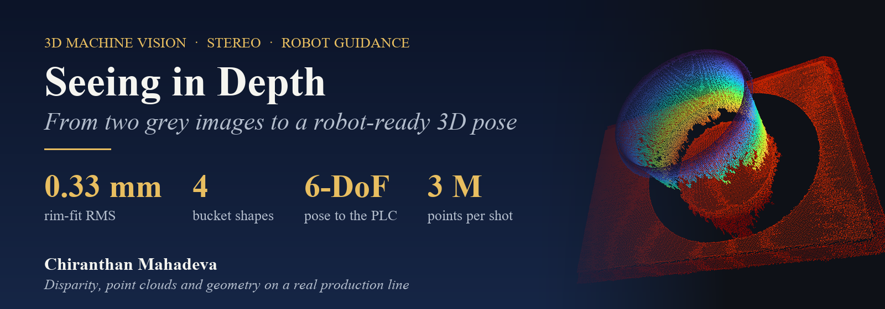
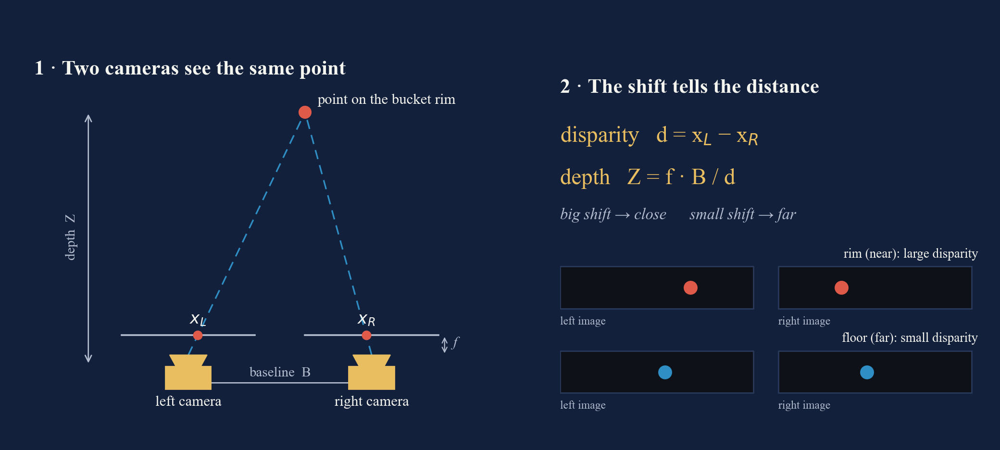
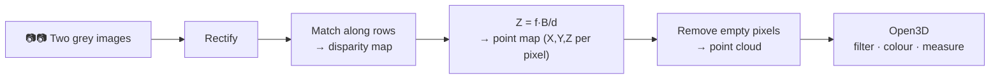
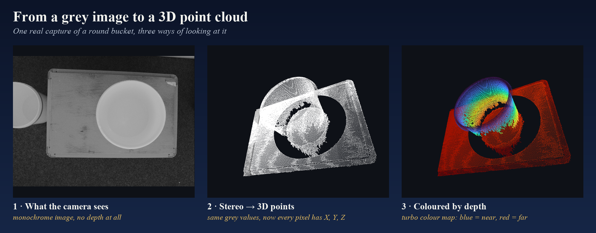
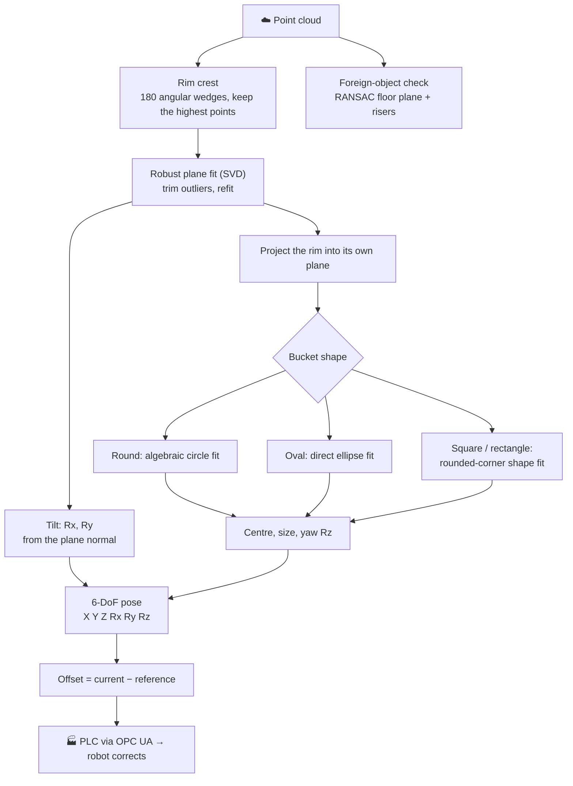
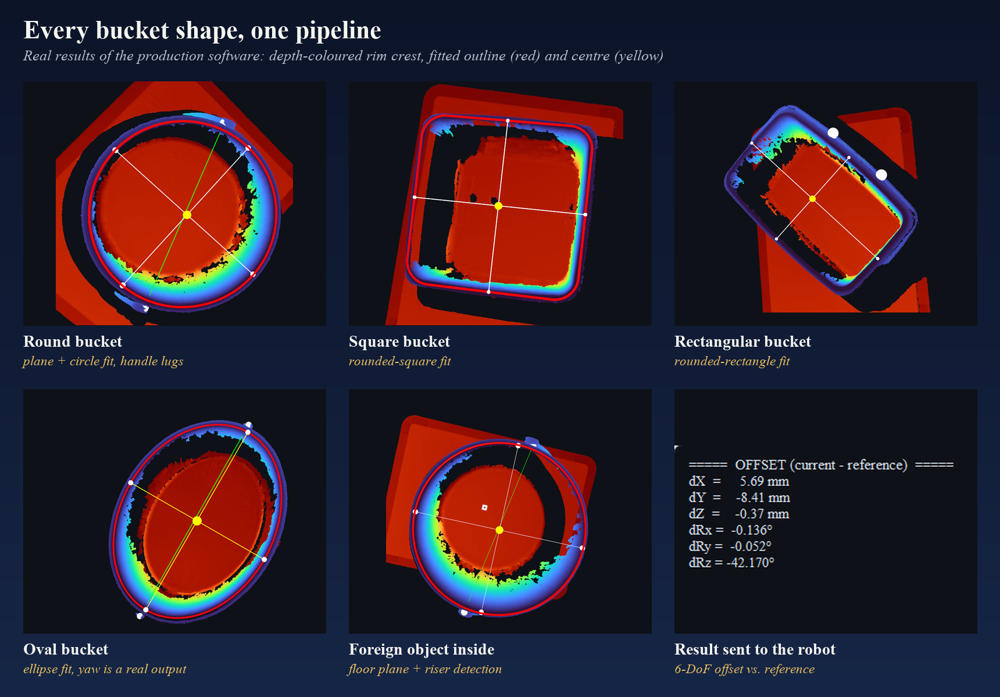

<p align="center">
  
</p>

<p align="center">
  
  
  
  
</p>

<p align="center">
  <b>A robot stacks plastic buckets. A 3D camera on the robot's arm measures each bucket's rim,<br>
  works out exactly where it is and how it's tilted, and tells the robot how to correct its path.</b>
</p>

> **Source code is private.** It was built for an industrial customer project. This page is a research write-up: how stereo 3D vision works, what I built with it, and what I learned. No client names are used. All images are real captures and real outputs of the software.

---

## 📖 Contents
1. [Why a normal camera wasn't enough](#1--why-a-normal-camera-wasnt-enough)
2. [How two cameras measure depth: disparity](#2--how-two-cameras-measure-depth-disparity)
3. [From disparity to a point cloud](#3--from-disparity-to-a-point-cloud)
4. [Making a grey cloud readable: colour by depth](#4--making-a-grey-cloud-readable-colour-by-depth)
5. [Finding the bucket: the geometry pipeline](#5--finding-the-bucket-the-geometry-pipeline)
6. [Results](#6--results)
7. [What I learned](#7--what-i-learned)

---

## 1 · Why a normal camera wasn't enough

The robot picks up a bucket and must place it **exactly** on the stack below. To do that it needs the target's **position (X, Y, Z)** and its **tilt (rotation around X, Y and Z)**: six numbers, called a **6-DoF pose**.

My first experiment used a normal **2D camera**. It found the bucket's X and Y well, but it **couldn't measure tilt or height**. A tilted bucket and a smaller bucket look almost the same in a flat image.

> 🔬 **Research result:** with 2D alone the tilt compensation can't be solved. That negative result is what moved the project to **3D stereo vision**.

## 2 · How two cameras measure depth: disparity

Our eyes judge distance because each eye sees the world from a slightly different position. A **stereo camera** does the same with two image sensors a fixed distance apart, the **baseline B**.

<p align="center"></p>

- The same point on the bucket rim lands at a slightly **different horizontal position** in the left and right image.
- That horizontal shift is the **disparity**: `d = x_L − x_R` (in pixels).
- **Close objects shift a lot, far objects shift only a little.** With the focal length `f` and the baseline `B`, the depth follows directly:

$$Z = \frac{f \cdot B}{d}$$

So measuring depth becomes a **matching problem**: for every pixel in the left image, find the same spot in the right image.

**How the camera solves that, step by step:**

| Step | What happens | Why |
|---|---|---|
| **Calibration** | Exact focal lengths, lens distortion and the position of the two sensors are measured once | All later maths depends on these numbers |
| **Rectification** | Both images are warped so matching points lie on the **same image row** | The search for a match becomes a fast 1-D search along a row |
| **Matching** | For every pixel, the best match on the same row of the other image is found | This gives the **disparity map**: one disparity value per pixel |
| **Triangulation** | `Z = f·B/d`, then X and Y from the pixel position | This gives the **point map**: an X, Y, Z for every pixel |

**When matching fails:** plain, texture-less surfaces (white plastic!) and spots that only *one* sensor can see (**occlusion**, for example behind a bucket wall) give no reliable match. Those pixels stay **empty**, and you can see them as the black "shadows" in the images below. This is why stereo cameras for industry often project a light pattern onto the scene: it gives smooth surfaces something to match.

## 3 · From disparity to a point cloud

A **point cloud** is simply a long list of 3D points, each one with **X, Y, Z** in millimetres (and optionally a colour). One capture from our camera produces about **3 million points**.



In code, the conversion is short. The camera delivers the point map as an image-shaped array (height × width × 3), and every pixel without a valid match is *NaN*:

```python
points = point_map.reshape(-1, 3)              # every pixel -> one (X, Y, Z)
valid  = np.isfinite(points).all(axis=1)       # drop pixels without a stereo match
cloud  = o3d.geometry.PointCloud()
cloud.points = o3d.utility.Vector3dVector(points[valid] / 1000.0)   # mm -> m
```

## 4 · Making a grey cloud readable: colour by depth

The camera is **monochrome**, so its point cloud is grey. That's accurate, but hard to read: a white bucket on a light floor is just "white on white".
The trick is to **colour every point by its depth**. In Open3D, each point's Z value is mapped onto a colour scale (*turbo*), and the scale is clipped to the 2nd–98th percentile so a few stray points can't wash out the colours.

<p align="center"></p>

```python
z  = points[:, 2]
lo, hi = np.percentile(z, [2, 98])                  # robust range, ignores flying pixels
t  = np.clip((z - lo) / (hi - lo), 0, 1)
cloud.colors = o3d.utility.Vector3dVector(matplotlib.colormaps["turbo"](t)[:, :3])
```

Suddenly the **rim** (nearest to the camera, blue), the **bucket walls** (green → yellow) and the **floor** (far, red) separate at a glance, both for the operator and for checking the algorithm.

## 5 · Finding the bucket: the geometry pipeline

The camera sits on the robot arm (**eye-in-hand**, about 45 cm above the bucket). From the cloud, the software finds the **top rim** and turns it into a pose:



**The key ideas:**

- **Rim crest in 180 wedges.** The cloud is cut into 180 pie slices around the bucket's centre, and each slice keeps only its **highest** points. That traces the rim even when parts of the wall are missing.
- **A tilt-proof plane.** A least-squares plane through the rim (via **SVD**) gives the rim's normal vector, and that normal *is* the tilt. Points far from the plane (wall pixels, flying pixels) are trimmed, then the plane is fitted again.
- **Fit the shape in the rim's own plane.** Projecting the rim into its plane makes the shape fit **independent of the tilt**. Each shape has its own model:
  - **Round**: algebraic least-squares circle (centre + diameter).
  - **Oval**: direct least-squares ellipse. Here the **yaw angle is a real output**.
  - **Square / rectangle**: real buckets have **rounded corners**, so the corner radius is a free parameter of the model. A plain rectangle would lock onto the corner curves and drift. Fitted robustly with iteratively re-weighted least squares.
- **Handles and lugs** are found as protrusions just below the rim.
- **Foreign objects** (anything left inside the bucket) are found by fitting the bucket **floor** with **RANSAC** and flagging points that rise above it.
- **Plug-in design.** Every shape is its own module with the same small interface, so adding a new bucket type doesn't touch the rest of the system.

## 6 · Results

<p align="center"></p>

| Check on a round reference bucket | Result |
|---|---|
| Diameter | Ø 353.3 mm |
| Measured tilt | 0.49° |
| Rim coverage (how much of the 360° ring was found) | 100 % |
| Fit residual (RMS distance of rim points to the fitted circle) | **0.33 mm** |

- **4 bucket shapes** (round, square, rectangle, oval), including **transparent** buckets.
- **6-DoF offset** against a saved reference, sent straight to the PLC over OPC UA.
- **PLC-driven mode**: the machine triggers every capture, and the operator only watches.
- Foreign objects of a few millimetres are detected inside the bucket.

## 7 · What I learned

1. **Negative results are results.** Proving that 2D *can't* solve tilt was the most important step toward the right solution.
2. **Work in the object's own coordinate frame.** Fitting the shape in the rim's plane turned a hard tilted problem into an easy flat one.
3. **Model the real object, not the ideal one.** Rounded corners and handles had to be part of the model, otherwise the fit drifted.
4. **Robust beats exact.** Percentile clipping, outlier trimming, IRLS and RANSAC matter more than the "perfect" formula, because real point clouds always have flying pixels and holes.
5. **Visualise everything.** Depth colouring made debugging possible and gave the operator instant trust in what the system sees.
6. **Next step: hand-eye calibration.** Poses are currently in the camera's frame and mapped to robot coordinates on the PLC side. A full hand-eye calibration would hand the robot its own coordinates directly.

## 🧰 Tech stack

**Python** · **Open3D** (point clouds, rendering) · **NumPy / SciPy** (SVD, least squares, IRLS) · **RANSAC** · stereo 3D camera SDK (disparity, point map) · **PySide6 + PyVista** GUI · **OPC UA** to the PLC

## 🔗 Related

- **[OPCUA-PLCVisionBridge](https://github.com/Gojoinferno/OPCUA-PLCVisionBridge)**: how the pose reaches the PLC.
- **[MachineVision-Research](https://github.com/Gojoinferno/MachineVision-Research)**: more machine-vision research notes.

---

<p align="center">
  <b>Chiranthan Mahadeva</b> · Industrial machine vision & 3D<br>
  More: <a href="https://github.com/Gojoinferno/Realtime-DigitOCR">Realtime-DigitOCR</a> ·
  <a href="https://github.com/Gojoinferno/PROFINET-PiRelay">PROFINET-PiRelay</a> ·
  <a href="https://github.com/Gojoinferno/RESTAPI-VisionGateway">RESTAPI-VisionGateway</a>
</p>
